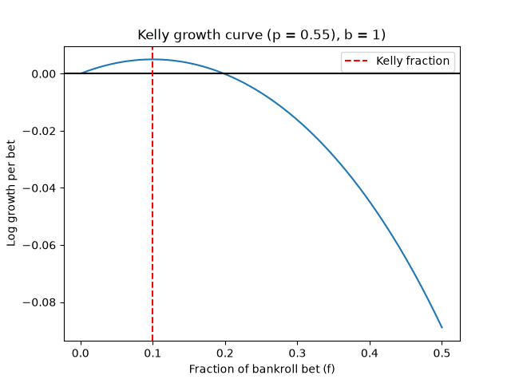

# Monte Carlo Option Pricer 

Vectorized Monte Carlo pricing engine for European options, checked using the Black-Scholes formula

## What it does

Simulates stock prices under geometric Brownian motion, and prices a European call as the discounted average payoff. Then validates the results against the Black-Scholes formula. Fully vectorized with NumPy. European call depends only on the final price, therefore a single time step is exact, which lets the convergence test reach 10^7 paths. Parameters were: S = 100, K=100, r = 5%(0.05), σ = 20%(0.2), T = 1 year. 

## Convergence Plot


The error falls as σ/sqrt(n), where n is the number of paths and σ ≈ 14.7 is the standard deviation of the discounted payoff. Taking 100 times more paths gives 10 times less error. The dots sit slightly below the red line because it shows the standard deviation of the error, while the dots show the average absolute error, which is about 0.8 of that.

## Kelly Criterion

`kelly.py` simulates repeated bets with win probability p and net payoff ratio b, then compares the median final bankroll with the theoretical e^(n * g), where g is the log growth per bet.



Growth peaks at the Kelly fraction 0.1, calculated from p - (1-p)/ b. Betting double Kelly gives zero growth, and any larger bet loses money despite the edge, which is why half-Kelly is common.

## How to run

```
pip install numpy scipy matplotlib
python price_paths.py
```

## Results

At 10^6 paths, Monte Carlo price was 10.4685 +/- 0.0147, against a Black-Scholes price of  10.4506, which falls within 1.2 standard errors, which is expected from sampling noise. Standard deviation of discounted payoff was found to be 14.73. Results may vary as is a random simulation

## Limitations

Only European calls. Assumes constant volatility and no dividends or trading costs. Kelly simulation assumes win probability is known beforehand and that bets are independent, which is rarley true.

